# RustMail

A fast, private desktop e-mail client written in Rust, with an interface modelled on
the 2025 "new Outlook": a slim app bar, a Home / View / Help ribbon, a folder pane with
Favorites, a Focused / Other message list and a card-style reading pane — in light and
dark themes. Mail, Calendar, People and To Do live in one window.

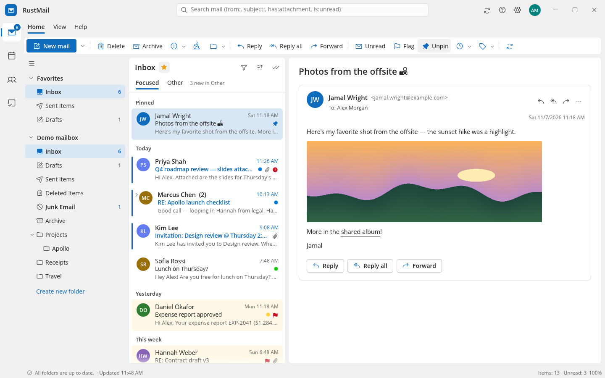

| | |
|---|---|
| 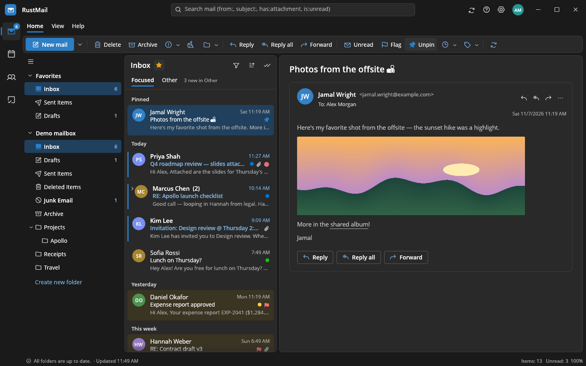 | 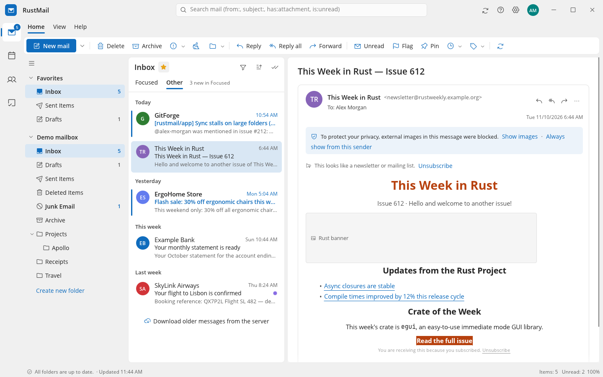 |
| 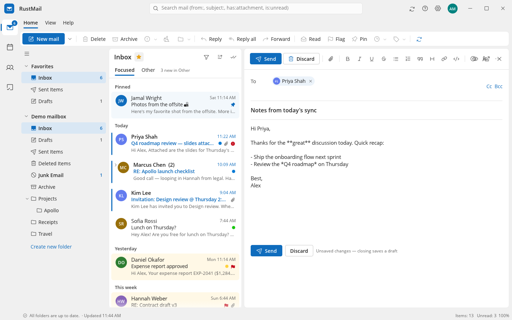 | 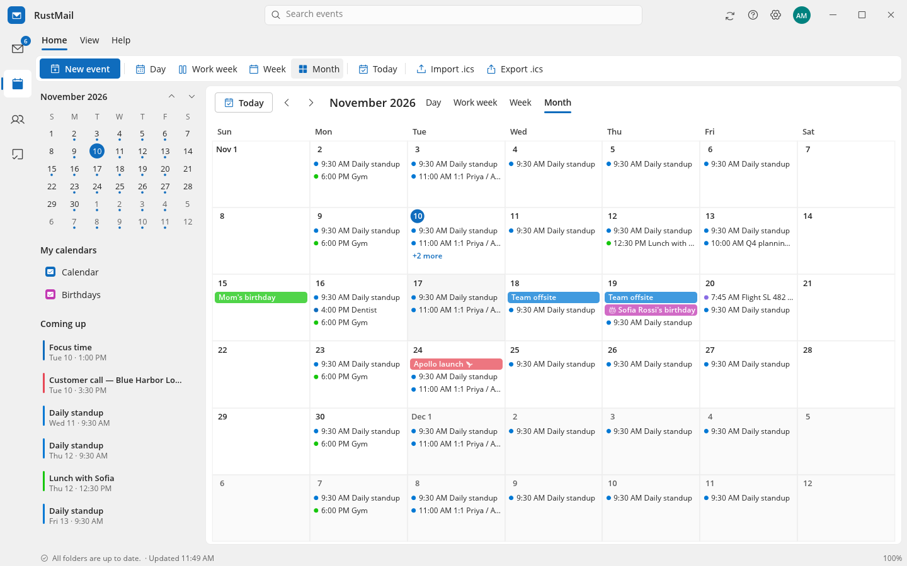 |
| 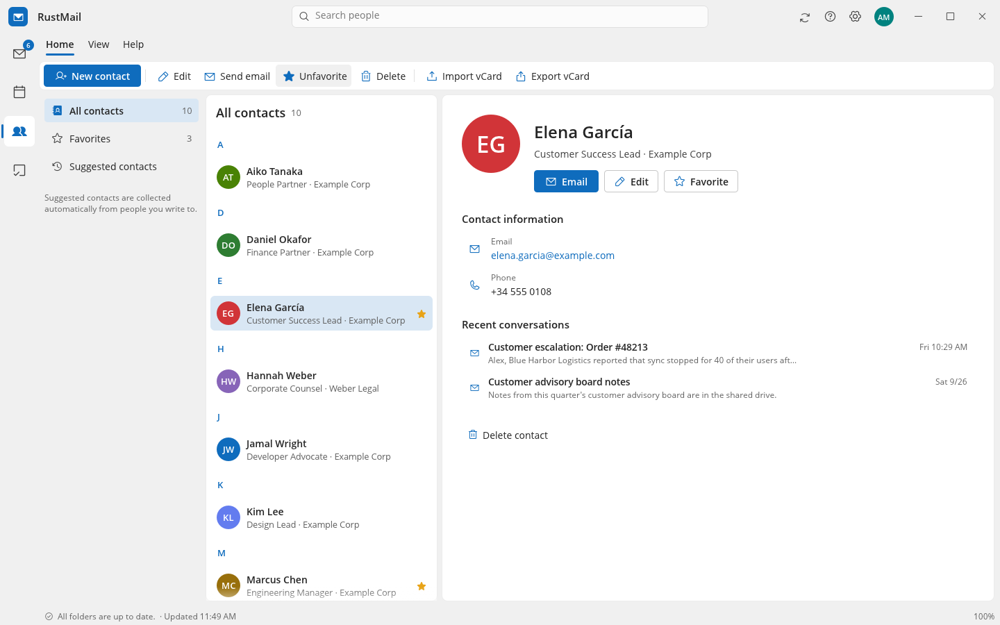 | 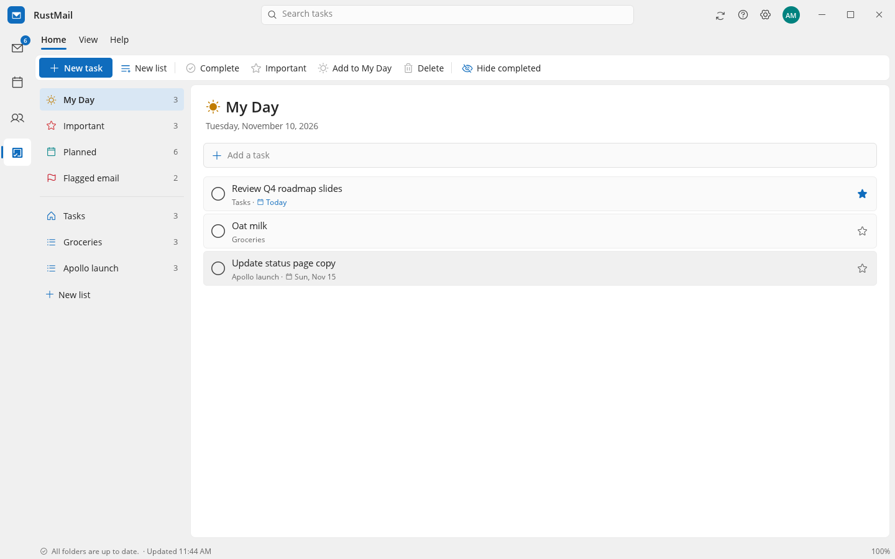 |
| 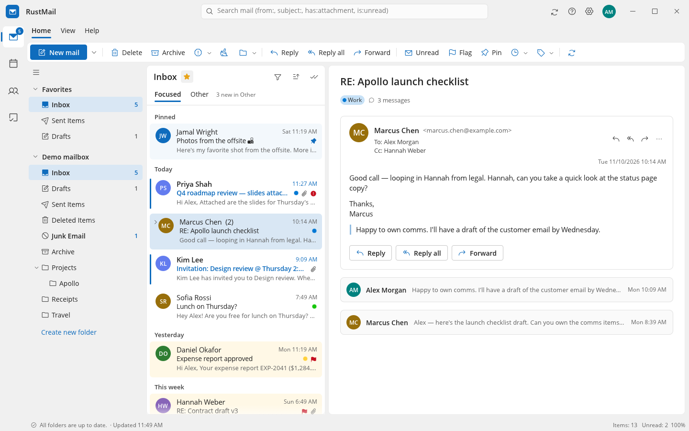 | 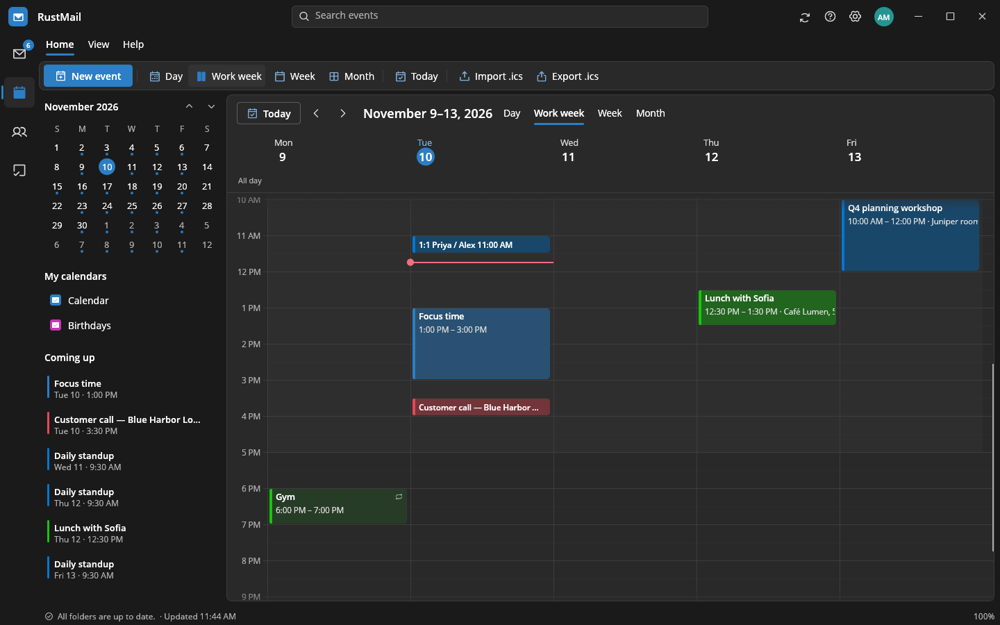 |
| 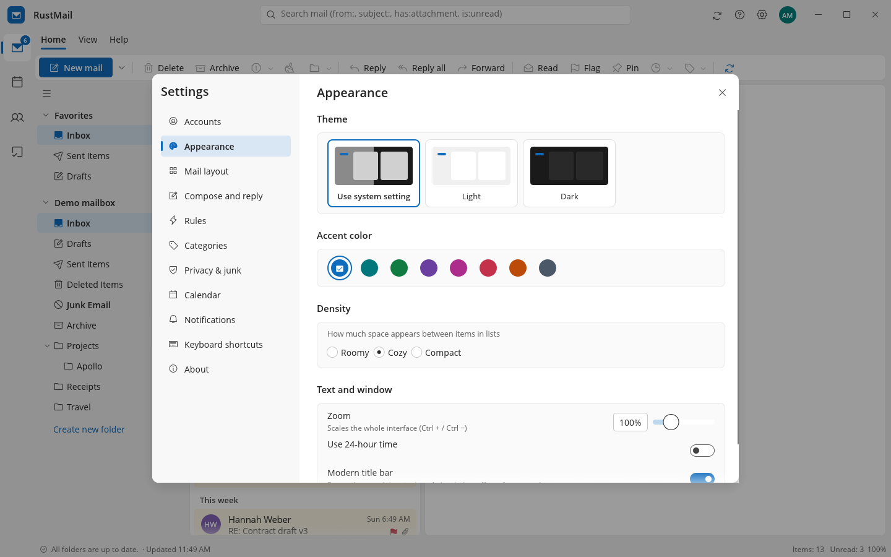 | 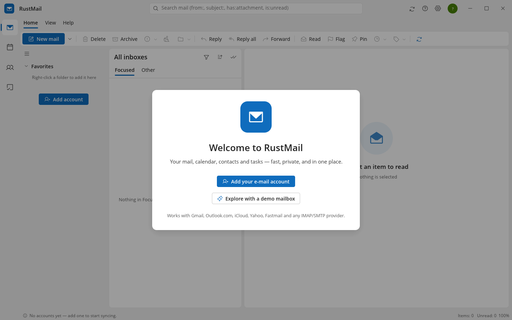 |

## Quick start

```bash
cargo run --release
```

The first start shows a welcome screen. Choose **Add your e-mail account** and type your
address — settings are found automatically — or **Explore with a demo mailbox** to try
everything offline with realistic sample mail, events, contacts and tasks
(`cargo run --release -- --demo` does the same from the command line).

Requirements: Rust 1.95+, a C compiler (SQLite is bundled) and a desktop with
Wayland or X11 and OpenGL. Passwords are kept in the system keychain (Secret Service on
Linux, Keychain on macOS, Credential Manager on Windows); if none is available they are
stored in a private file (mode 0600) in the data folder.

## Features

**Mail**
- IMAP sync for any number of accounts, with **push mail (IMAP IDLE)**, periodic sync and
  `F9` send/receive; works offline from the local cache.
- **Easy setup**: enter an address and RustMail finds the servers via built-in presets
  (Gmail, Outlook.com / Microsoft 365, iCloud, Yahoo, AOL, Fastmail, Zoho, GMX, WEB.DE,
  Yandex, Mail.ru, Proton Bridge, mailbox.org, Posteo, Comcast), the provider's own
  autoconfig file, Mozilla's ISP database, the domain's MX records (e.g. Google Workspace
  and Microsoft 365 custom domains) and finally probing common host names. Every setting
  can be edited by hand; connections are tested before an account is saved.
- Password / app-password sign-in, or **OAuth 2.0** (PKCE, browser sign-in) with your
  own client ID for Google and Microsoft.
- **Focused Inbox** (newsletters and notifications go to *Other*; "Always move to
  Focused/Other" per sender), **conversation view**, pinning, flags, categories,
  snooze, sweep, junk / not junk, block sender, unified "All inboxes".
- Virtualised message list grouped by date, hover actions, multi-select
  (Ctrl/Shift-click or the round check boxes), drag messages onto folders, context menus.
- **Reading pane** right, bottom or off; threaded conversation cards, safe HTML rendering
  (no scripts, remote images blocked until you allow them, tracking pixels dropped, dark
  mode colour adaptation), inline images, attachments (open / save / save all), meeting
  invitations with **Accept / Tentative / Decline** (sends an iMIP reply), read-receipt
  requests, one-click unsubscribe, view source, save as `.eml`.
- **Compose** inline or in its own window: recipient "pills" with contact
  auto-complete, Cc/Bcc, formatting toolbar (Markdown → HTML, with live preview; a
  plain-text part is always included), attachments (button or drag-and-drop), importance,
  read receipts, signatures per account, drafts saved to the server, **undo send**.
- Full-text search across all folders (SQLite FTS5) with operators:
  `from:`, `to:`, `subject:`, `has:attachment`, `is:unread|read|flagged|pinned`,
  `before:YYYY-MM-DD`, `after:YYYY-MM-DD`.
- Inbox **rules** (conditions on from / to / subject / body / attachments; actions move,
  mark read, flag, pin, categorize, delete, move to Other).
- Folder management: create, rename, delete, empty, mark all read, favorites.
- Undo for delete / archive / move (server changes are applied after the undo window).
- Failed sends stay in the outbox with Retry / Discard.

**Calendar** — day, work week, week and month views, mini month, overlap-aware layout,
all-day and multi-day events, repeating events (daily, weekdays, weekly, monthly,
yearly), reminders with desktop notifications, categories, "show as", birthdays from
contacts, `.ics` import/export, sending invitations.

**People** — contacts with favorites, details, notes and recent conversations;
suggested contacts collected from mail you send; vCard import/export.

**To Do** — My Day, Important, Planned, Flagged email (completing one clears the flag),
custom lists, due dates, reminders and notes.

**Look and feel** — light / dark / system theme, eight accent colours, Compact / Cozy /
Roomy density, zoom (Ctrl +/−), 12/24-hour time, modern title bar with search (or native
window decorations), resizable panes that remember their size.

## Keyboard shortcuts

| Keys | Action |
|---|---|
| Ctrl+N | New message / event / contact / task |
| Ctrl+R / Ctrl+Shift+R / Ctrl+F | Reply / Reply all / Forward |
| Ctrl+Enter, Ctrl+S | Send, save draft (while composing) |
| Delete, Shift+Delete | Delete, delete permanently |
| E or Backspace | Archive |
| Ctrl+Q / Ctrl+U | Mark read / unread |
| Insert | Flag |
| Ctrl+Shift+V | Move to folder |
| ↑ ↓ or K J, Enter | Navigate, open |
| Ctrl+E or F3 | Search |
| F9 | Send / receive |
| Ctrl+1 … Ctrl+4 | Mail, Calendar, People, To Do |
| Ctrl+, | Settings |

## Configuration

Everything is configurable in **Settings** (gear icon or `Ctrl+,`). Files live in the
platform folders:

| | Linux | macOS | Windows |
|---|---|---|---|
| Settings (`config.toml`) | `~/.config/rustmail/` | `~/Library/Application Support/org.RustMail.RustMail/` | `%APPDATA%\RustMail\RustMail\config\` |
| Mail cache (`mail.db`) | `~/.local/share/rustmail/` | same as settings | `%APPDATA%\RustMail\RustMail\data\` |

Set `RUSTMAIL_HOME=/some/dir` (or pass `--data-dir /some/dir`) to keep everything in
one folder, e.g. for a portable install. `config.toml` is plain TOML; an account looks
like this:

```toml
[[accounts]]
id = "work"
label = "Work"
display_name = "Jane Doe"
email = "jane@example.com"
sync_interval_min = 5
push = true

[accounts.imap]
host = "imap.example.com"
port = 993
security = "Tls"          # Tls | StartTls | None
username = "jane@example.com"

[accounts.smtp]
host = "smtp.example.com"
port = 587
security = "StartTls"
username = "jane@example.com"
```

Command-line options: `--demo`, `--data-dir DIR`, `--module mail|calendar|people|todo`,
`--theme light|dark`, `--wizard`, `--settings`, `--help`.

### Provider notes

- **Gmail / Google Workspace**: create an app password (needs 2-Step Verification) or
  use OAuth with your own Google Cloud "Desktop app" client ID and secret. Turn off
  "Save a copy of sent messages" (Gmail does it itself — this is the default).
- **Outlook.com / Microsoft 365**: Microsoft requires OAuth. Register a public client
  in Azure (redirect URI `http://localhost`) with the `IMAP.AccessAsUser.All` and
  `SMTP.Send` permissions, then paste its client ID.
- **iCloud, Yahoo, AOL, Fastmail**: use an app-specific password.
- **Proton Mail**: run Proton Mail Bridge; the preset points at it and accepts the
  Bridge's self-signed certificate.

## Development

```bash
cargo test                     # unit tests (store, MIME, HTML renderer, calendar, rules, …)
```

End-to-end tests run the real sync engine against a local IMAP + SMTP server:

```bash
python3 -m venv .venv && .venv/bin/pip install twisted aiosmtpd
.venv/bin/python tools/testserver.py &          # IMAP :1143, SMTP :2525
cargo test -- --ignored live_imap --nocapture   # restart the server between runs
cargo test -- --ignored live_discover --nocapture   # auto-discovery (uses the network)
```

The live test covers sign-in, folder discovery, initial sync, body download, flag and
move round-trips (verified on the server), sending with a Sent copy, drafts, folder
create/rename/delete, delete and empty trash, and push delivery via IDLE.

Set `RUSTMAIL_SCREENSHOT=out.png` to make the app save a screenshot of its window after
start-up and exit (useful for visual checks in CI).

### Layout of the code

| Path | Purpose |
|---|---|
| `src/app.rs` | Application state, events from the engine, timers, shortcuts |
| `src/ui/` | Shell (title bar, app bar, ribbon), mail, compose, calendar, people, to-do, settings, setup wizard, widgets, HTML renderer |
| `src/engine/` | Background sync engine (tokio): one actor per account, IMAP (`async-imap`), SMTP (`lettre`), auto-discovery, OAuth, rules |
| `src/store.rs` | SQLite cache with FTS5 search, contacts, events, tasks, outbox |
| `src/mime.rs` | Parsing (`mail-parser`) and building (`lettre`) messages |
| `src/cal.rs`, `src/vcard.rs` | iCalendar and vCard |
| `src/demo.rs` | The offline demo mailbox |

## Known limitations

- Calendar and contacts are local (import/export via `.ics` / `.vcf`); there is no
  CalDAV/CardDAV or Exchange sync yet. Times in invitations that use a named time zone
  are read as local time.
- POP3 is not supported.
- The HTML renderer favours readability over pixel-perfect layout: table-based designs
  are shown as a single column, and CSS beyond inline styles is ignored.
- Rich-text composing uses Markdown syntax with a preview rather than WYSIWYG editing.
